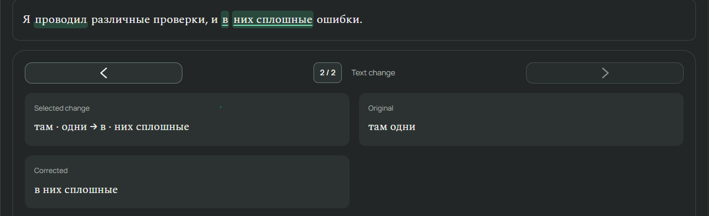

1 - FIX: when closing the app and reopening it, the focus is on "Result" hovered.

2 - FIX: the ui shows selected changes. What is it. remove it from the ui

3 - after generating a correction, if it is needed there should be small scroll dowm. (SMALL) and only if needed.

4 - FIX: GENERATE AGAIN SHOULD BE JUST ABOVE SECON OPINION ON MOBILE

5 - FIX: When we open in history a correction that already has an explanation first the delete button loads and then the explanation loads. It's not user-friendly. Maybe some lazy loading will help.

6 - Feat: Export functionality for llm agentsand other.

7 - .\gramika_manual_selection_explain_spec.md

8 - docs\gramika_text_diff_implementation_handoff.md
