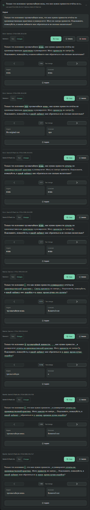

# Грамика — Research Brief: Meaningful Text-Diff Grouping

**Type:** Research and design investigation only  
**Status:** Open problem; no solution or user-facing grouping policy has been approved  
**Audience:** Research / engineering agent with access to the Грамика codebase

## 1. Objective

Investigate how Грамика should detect, present, and group changes between original Russian text and AI-corrected or rewritten text. We have found that _accurately identifying textual differences_ is not the same as _organizing them into understandable editing operations_. Current behavior can be technically faithful while producing fragmented, awkward, or potentially misleading selections for the **Explain** feature.

The task is to research the problem broadly, inspect the existing implementation, compare realistic alternatives and their trade-offs, and advise whether any change is worth making. **Do not presuppose that better linguistic grouping is necessary or that an LLM is the answer.** Avoid over-engineering a working personal-use application.

**No implementation, refactor, tests that call paid models, commits, deployment, or prompt edits as part of this research.** Propose possible experiments and acceptance criteria, but wait for approval before implementing.

## 2. Relevant product behavior and context

Грамика is a browser-based Russian proofreading and rewriting application with a Node.js backend. It supports:

- **Strict Correction:** fixes spelling, punctuation, grammar and clearly unnatural constructions while minimizing unnecessary rewriting.
- **Gentle Rewrite:** allows broader phrasing and stylistic changes while aiming to preserve meaning and voice.
- **Word-aware text diff:** highlights changes between the original and returned text.
- **Change-based Explain:** clicking a highlighted change explains _why the correction or rewrite was made_, using Strict or Rewrite explanation prompts.
- **Manual selection / Expression Explain:** users can select text in **either** the original or edited pane, including unchanged text, to learn its meaning, grammar, or usage. This is independent of diff groups. This feature has been implemented.

A proposed **V3.5 contextual comparison** was deliberately cancelled as redundant: clicking highlighted changes already answers “why changed?”, while selecting an expression answers “what does this mean/how is it used?”. **Do not reintroduce V3.5 as the presumed solution.** Existing Explain prompts were previously reviewed and are not in scope for modification.

The user values multiple correction/rewrite variants and regards them as a potential feature, _not_ as a diff bug. Different LLM outputs naturally produce different changes. Research the **representation of changes within each result**, not how to force multiple outputs to be identical.

## 3. Existing implementation: inspect, do not assume

A revised, deterministic, word-aware diff was implemented and then stabilized. Its intended conceptual layers are:

1. Tokenize words, punctuation and whitespace with exact offsets and Unicode/grapheme safety.
2. Align tokens to find matching anchors and insertions/deletions/replacements.
3. Build small changes; highlight changed words as words, with independent punctuation and whitespace handling.
4. Conservatively group strongly related edits (such as split/join and clear replacements).
5. Detect unambiguous moved words/phrases; a logical group may reference multiple separated spans.
6. Render **exact changed spans** independently from larger **comparison/explanation context**.
7. Preserve exact reconstruction, complete edit coverage, deterministic behavior and bounded comparison cost.

The implemented stabilization work targeted sentence-count-dependent movement detection and pathological movement-search performance. **Inspect the current code and tests to determine the actual behavior**; do not assume earlier problems remain unfixed. Locate the library, public types, alignment and grouping passes, movement logic, UI interactions, Explain request construction, and related tests. Describe the actual pipeline with file paths and relevant functions.

**Important vocabulary:**

- **Detection/alignment:** finding where source and target texts differ.
- **Grouping:** associating one or more detected edits with one user-selectable logical correction.
- **Highlighting:** marking actual changed spans in the UI; unchanged context should not be falsely colored as edited.
- **Explain context:** the before/after passages passed to the language model so it can discuss the selected operation.

Grouping is part of the diff system, **not** an independent product feature. The relationship among these layers is central to the research.

## 4. Why this research is needed

Our earlier rule of **conservative grouping** prevents unrelated edits from being merged, but can fragment a meaningful sentence restructuring into several selections. This can result in change-based explanations that discuss a deletion or punctuation mark in isolation, instead of the larger reformulation. Conversely, merging too aggressively could combine unrelated grammar and punctuation fixes and produce a vague or inaccurate explanation.

We have not decided where the best balance lies. **This is an explicit research question, not a missing requirement to be guessed.** The researcher should compare possible user-facing policies and demonstrate their effects on real examples before recommending one.

### Example A — Deleted phrase and shifted punctuation

Original (illustrative variant):

> Я вспомнил чрезвычайную вещь, что нужно сдать отчёт.

Edited:

> Я вспомнил, что нужно сдать отчёт.

The literal changes include deletion of `чрезвычайную вещь` and punctuation restructuring. The question is whether the UI should expose these as separate changes or one connected reformulation, and what Explain should receive. **Do not assume one grouped change is necessarily best.** Check the real implementation's segmentation rather than trusting this schematic description.

### Example B — Distinct nearby corrections

Original:

> Вчера я отправел преподавателю важная письмо но он пока не ответил.

Edited:

> Вчера я отправил преподавателю важное письмо, но он пока не ответил.

A reasonable expectation is separate selectable corrections for `отправел → отправил`, `важная → важное`, and the inserted comma before `но`. The unchanged noun `письмо` should not be falsely highlighted. Proximity alone should not automatically produce one large group.

### Example C — Grammatically related but textually distinct

Original:

> Она был готов.

Edited:

> Она была готова.

The agreement changes `был → была` and `готов → готова` are linguistically related. A text-only algorithm cannot conclusively infer that relationship from adjacency. Should grouping attempt it, leave them separate with sentence context, or use another method? Examine the costs and risks.

### Example D — Phrase replacement with unchanged interior anchor

Original:

> в связи с тем, что

Edited:

> потому что

The phrase is substantially replaced, but `что` remains. Explore whether one group is desirable while leaving identical text unhighlighted.

### Example E — Split/join

`по этому → поэтому` should normally be understood as one change, despite changes to token boundaries.

### Example F — Relocation and ambiguous attribution

Original:

> Я пока не могу точно обещать.

Edited:

> Я не могу пока точно обещать.

Two formal edit descriptions exist: move `пока` or move `не могу`. An earlier decision favored the smallest _unambiguous_ movement; for `А Б → Б А`, genuine ambiguity should not be falsely presented as a confident move. The purpose of this brief is **not to reopen every settled invariant**, but to assess how movement groups interact with readable change selections.

### Example G — Actual Грамика correction session

User-provided original:

> Только что вспомнил чрезвычайную вешь, что мне нужно принести отчёты по производственным практиках в университет. Могу их завтра принести. Подскажите, пожалуйста, в каком кабинете мне обратиться и во сколько желательно?

Examples of returned variants included:

**Strict (Gemma 4):**

> Только что вспомнил чрезвычайную вещь: мне нужно принести отчёты по производственным практикам в университет. Могу принести их завтра. Подскажите, пожалуйста, в каком кабинете мне обратиться и во сколько желательно?

**Another Strict (Gemma 4):**

> Только что вспомнил про чрезвычайную вещь: мне нужно принести отчёты по производственным практикам в университет. Могу принести их завтра. Подскажите, пожалуйста, в какой кабинет мне обратиться и во сколько желательно?

**Gentle Rewrite (Gemma 4):**

> Только что вспомнил, что мне нужно принести в университет отчёты по производственной практике. Смогу принести их завтра. Подскажите, пожалуйста, в какой кабинет мне подойти и в какое время лучше это сделать?

The user saw several selectable fragments and wondered whether they were bugs. The distinction emerged between **correct textual detection** and **potentially unhelpful grouping**, particularly around `чрезвычайную вещь`, punctuation and sentence restructuring. The multiple LLM variants were **not** the problem. Use the real outputs and exact change-group data, if available, to reconstruct what the UI does; do not assume screenshot interpretation or the earlier assistant's diagnosis is proof of a bug.

Other useful regression categories: punctuation-only edits; reordered pronouns; alternative inflections; substantial sentence rewrites; repeated words; changes at paragraph boundaries; Cyrillic `е/ё`; emoji; combining characters; CRLF, tabs, NBSP and repeated whitespace; very long or repetitive passages.

## 5. Broad research scope — do not favor a solution in advance

Investigate **how existing software and literature solve or sidestep the same problem**, distinguishing products' observed UX from their publicly documented internal algorithms. Cover relevant categories such as:

- Traditional text diff and word diff, including sequence alignment, cleanup, tokenization and change hunk construction.
- Editors and code review tools that group changes into hunks, inline edits or staged revisions.
- Writing assistants, proofreading interfaces and word processors that present grammar suggestions and broader rewrites (e.g., Grammarly, LanguageTool, Microsoft Word/Track Changes, Google Docs, or other relevant products). **Do not assert their internal algorithms without evidence.**
- NLP-based approaches such as syntax, morphology, phrase boundaries, alignment and edit-operation classification; assess usefulness for Russian.
- Research on edit alignment and grammatical error correction evaluation/annotation (including how different valid alignments are handled).
- Optional LLM-assisted grouping: an LLM working directly from both texts; an LLM grouping deterministic edit IDs; or structured edits emitted during correction. Include validation approaches and failure risks.
- **Deliberately simple alternatives:** leaving the current grouping alone, changing presentation or context only, selective/manual grouping, or simplifying the Explain interaction. A non-change option must receive a fair comparison.

Compare the methods along common criteria: quality of grouping, faithfulness/completeness of diff coverage, highlighting precision, deterministic/reproducible behavior, performance, API cost, latency, Russian-language suitability, implementation/maintenance complexity, explainability, and UX. Address failure modes such as invented correspondences, overly broad hunks, missing punctuation, and disagreement across runs.

If searching external sources, provide primary documentation, implementation links and relevant papers where feasible. Clearly distinguish **observed facts**, **published methods**, and **your own hypotheses**. Licensing and deployment limitations matter if an external library or service is recommended.

## 6. Product and UX questions to investigate

The user **has not chosen an ideal grouping policy**. Do not force “one linguistic change = one group” or “always smallest edit” as an assumption. Compare at least these possible outcomes:

1. **Fine-grained:** maximize independent corrections; rely on Explain context to handle surrounding relationships.
2. **Phrase-oriented:** merge connected reformulations into larger selectable operations without highlighting unchanged words.
3. **Hybrid/adaptive:** perhaps different grouping thresholds or display modes, including the possibility that Strict and Gentle Rewrite have different needs.
4. **Minimal change:** keep groups as they are and improve how explanations contextualize selected fragments, if that is sufficient.

Questions:

- When is a small fragment _actually harmful_ versus merely less elegant?
- Which grouping behavior makes **change-based Explain** more accurate and understandable?
- Does grouping improve the user's ability to review edits independently?
- Can the existing **manual text selection** solve some problems without making change-based Explain redundant?
- Would separate selection spans and explanation context be sufficient instead of new grouping heuristics?
- What should happen for ambiguous edits, repeated tokens, partial sentence replacement, and punctuation coupled with word deletion?
- Could grouping become unexpectedly different across small source revisions and thereby confuse the user?
- Is the current system already “good enough” given the application's personal-use status?

Include a few **side-by-side visual or structured examples** of each proposed policy using exactly the same source/target pairs. Show the change units, precisely what is highlighted, and what Explain would receive. This comparison is more useful than abstract scoring claims.

## 7. Constraints and non-goals

- **Research only.** No implementation, migrations, prompt changes or automatic benchmark/model calls.
- **Don't redesign the product.** The user dislikes over-engineering and unnecessary architecture.
- Keep separate the tasks “explain why this changed” (click on diff) and “explain this expression” (manual selection in original/edited text).
- Preserve precise, truthful highlighting and complete edit coverage as quality requirements.
- Keep OpenRouter, model choices, correction prompts, rewrite prompts, Explain prompts, History and existing unrelated UI out of scope.
- Do not assume a new dependency, external hosted service, or paid model call is justified.
- Do not assume that the LLM must be added; treat it as one option to assess rigorously.
- If evaluation with real paid LLM calls would help, **request explicit permission first**; use exported/preexisting correction results where possible.
- Maintain realistic expectations: arbitrary sentence rewrites often admit multiple defensible alignments, with no unique “ground truth” grouping.

## 8. Required deliverable

Provide a **research report**, not a code patch, organized as follows:

1. **Current-state audit:** Grounded explanation of the implemented pipeline, data structures, current behavior and observed limitations, with file/function references.
2. **Problem definition:** Which issues are confirmed bugs, inherent alignment ambiguities, grouping policy trade-offs, or Explain-context/UI issues?
3. **External research:** Examples from comparable tools, open-source implementations and literature, citing reliable sources and separating observable UX from hidden implementation details.
4. **Approach comparison:** At minimum: keep as-is, improved deterministic grouping, NLP-assisted grouping, LLM-assisted grouping. Include other credible approaches discovered. State pros, cons, cost, latency and maintenance complexity; distinguish proven behavior from estimates.
5. **Example-driven UX comparison:** Show what each plausible approach would do on the same realistic Russian before/after pairs, notably the `чрезвычайную вещь` case and a case with independent corrections.
6. **Recommendation:** A **minimal, proportionate** next step, including the possibility of _no immediate change_. Explain why the expected UX benefit is worth its complexity.
7. **Validation proposal:** A small set of reproducible source/target examples, measurable invariants, manual UX evaluation criteria and a way to compare approaches fairly. No automated paid-model invocation.
8. **Uncertainties and decisions for the user:** Explicitly identify questions that research cannot settle technically because they depend on taste, learning goals or UI preference.

**Stop after the report and recommendations. Do not implement or silently decide unresolved UX trade-offs on the user's behalf.**

# EXEMPLE:

